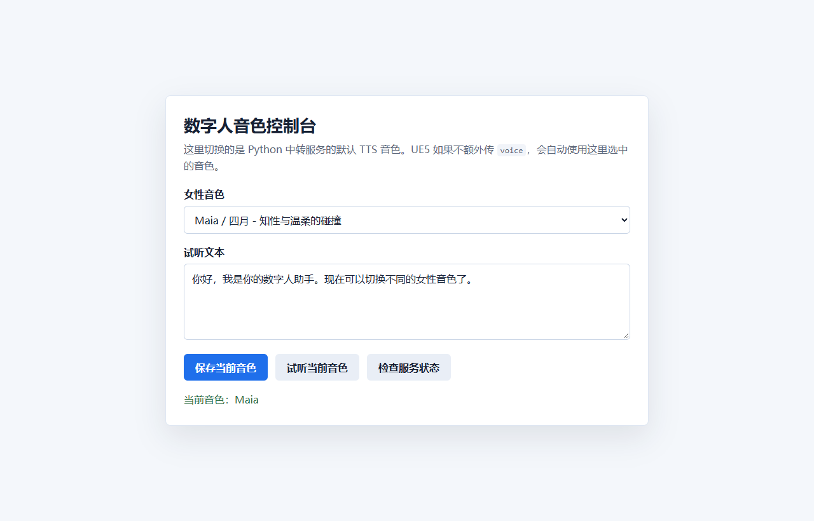
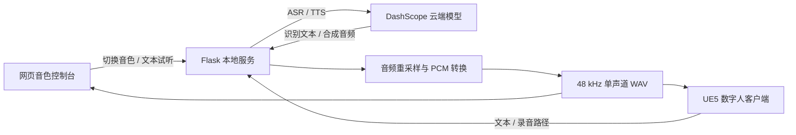

# 数字人音色控制台

**面向 Unreal Engine 5 数字人的本地语音服务与音色试听工具。**

使用 Python / Flask 连接阿里云 DashScope，将语音识别（ASR）、语音合成（TTS）、音色切换和音频格式转换整合到同一个本地服务中。网页负责选择和试听音色，UE5 通过 HTTP 接口读取识别文本或生成的 WAV 文件。




## 项目功能

| 功能 | 实现 |
| --- | --- |
| 音色控制 | 内置 22 个音色选项，网页切换服务默认音色，支持请求单独指定音色 |
| 语音试听 | 输入文本后生成语音，在网页音频播放器中试听 |
| 语音合成 | 调用 `qwen3-tts-flash`，下载音频并返回本地文件路径及播放 URL |
| 语音识别 | 将本地录音转换为 16 kHz 单声道 WAV，调用 `paraformer-realtime-v1` 返回文本 |
| UE5 音频输出 | 统一输出 48 kHz / 单声道 / PCM 16-bit WAV，方便数字人播放及口型流程接入 |
| 音频处理 | 使用多相滤波重采样；符合目标格式的音频直接复制，避免重复转换 |
| 性能观察 | 接口返回合成、下载、转换、识别及总耗时，便于定位等待环节 |
| 本地部署 | Waitress 服务、健康检查、重复启动检测与 PyInstaller 打包配置 |

## 工作流程



仓库提供语音服务和控制台源码。UE5 工程、数字人模型与口型插件需自行准备；本仓库不包含 LLM 对话生成。语音识别与合成由云端模型完成。

## 快速运行

已在 Windows / Python 3.11 下验证。需要可访问 DashScope 的网络，以及具备对应模型权限的 API Key。

```powershell
git clone https://github.com/cyf84/digital-human-voice-console.git
cd digital-human-voice-console
python -m venv .venv
.\.venv\Scripts\python.exe -m pip install -r requirements.txt
Copy-Item .env.example .env
```

在本地 `.env` 文件中填写自己的密钥：

```dotenv
DASHSCOPE_API_KEY=your_dashscope_api_key
```

也可以设置同名环境变量，环境变量优先于 `.env`。服务启动后读取配置，修改密钥需重启服务。

```powershell
.\.venv\Scripts\python.exe server2.py
```

浏览器访问 **http://127.0.0.1:5000/**。没有配置密钥时，控制台、音色切换和健康检查仍可使用，语音请求会返回配置提示。

## UE5 / HTTP 接入

UE5 与服务运行在同一台电脑，通过 HTTP 发送 JSON。ASR 的 `audio_path` 必须是服务进程可读取的本地文件路径；TTS 返回的 `audio_path` 可供 UE5 读取。

| 方法 | 路径 | 用途 |
| --- | --- | --- |
| GET | `/` | 音色控制台 |
| GET | `/health` | 服务状态、默认音色、输出目录 |
| GET | `/voices` | 音色列表及默认音色 |
| POST | `/set_voice` | 设置默认音色 |
| POST | `/generate_voice` | 文本生成语音 |
| POST | `/recognize_speech` | 本地录音识别为文本 |
| GET | `/audio/<file_name>` | 播放或下载生成的 WAV |
| GET | `/routes` | 查看路由列表 |

### 生成语音

```powershell
$body = @{ text = "你好，我是你的数字人助手。"; voice = "Maia" } | ConvertTo-Json
Invoke-RestMethod -Method Post -Uri http://127.0.0.1:5000/generate_voice `
  -ContentType "application/json; charset=utf-8" -Body ([Text.Encoding]::UTF8.GetBytes($body))
```

返回结构示例（路径和耗时仅为格式示意）：

```json
{
  "status": "success",
  "audio_path": "D:/digital-human-voice-console/tts_output/tts_example_ue5.wav",
  "audio_url": "/audio/tts_example_ue5.wav",
  "text_echo": "你好，我是你的数字人助手。",
  "voice": "Maia",
  "timing": { "tts": 1.5, "download": 0.3, "convert": 0.1, "total": 1.9 }
}
```

省略 `voice` 时使用网页选中的默认音色。该选择保存在进程内存中，重启后恢复源码默认值 `Maia`。`audio_url` 是相对路径，完整地址需加上 `http://127.0.0.1:5000`。

### 识别录音

```powershell
$body = @{ audio_path = "D:/UE_Project/Saved/TempAudio/recording.wav" } | ConvertTo-Json
Invoke-RestMethod -Method Post -Uri http://127.0.0.1:5000/recognize_speech `
  -ContentType "application/json; charset=utf-8" -Body ([Text.Encoding]::UTF8.GetBytes($body))
```

返回 `status`、`text` 和 `timing`。转换产生的 ASR 临时文件在请求结束后清理；TTS 仅保留最终 `_ue5.wav` 文件。

## 验证与打包

```powershell
python -m unittest discover -s tests -v
```

7 项离线测试覆盖无密钥页面访问、音色切换、参数校验、缺失密钥处理、立体声音频转换、符合格式音频直接复制，以及模拟云端返回后的 TTS 下载、转换与播放接口。GitHub Actions 自动运行这些检查；测试使用模拟云端响应，不代表真实云端调用或 UE5 口型效果验收。

Windows 下可自行构建可执行程序：

```powershell
python -m pip install pyinstaller==6.19.0
python -m PyInstaller server2.spec
Copy-Item scripts\Start_Server.bat dist\Start_Server.bat
Copy-Item .env.example dist\.env
```

填写 `dist/.env` 后运行 `dist/Start_Server.bat`。密钥不嵌入可执行文件；分享构建产物前移除自己的 `.env`。`deploy_to_digital_human.ps1` 是现有 Windows 部署示例，使用前按自己的 UE5 打包目录修改目标路径。

## 文件结构

```text
server2.py                     Flask 接口、网页控制台、云端调用与音频处理
server2.spec                   PyInstaller 单文件打包配置
requirements.txt               运行依赖
.env.example                   不含密钥的配置示例
scripts/Start_Server.bat        Windows 打包版启动器
deploy_to_digital_human.ps1     UE5 打包目录部署示例
tests/test_service.py          离线接口与音频测试
docs/images/voice-console.png  实际运行页面截图
.github/workflows/checks.yml   自动化检查
```

服务默认仅监听 `127.0.0.1:5000`，用于同机数字人工作流；接口没有身份认证。云端模型权限、音色可用性与调用费用以服务商账户为准。密钥、日志、生成录音和已有打包产物均不提交到仓库。
